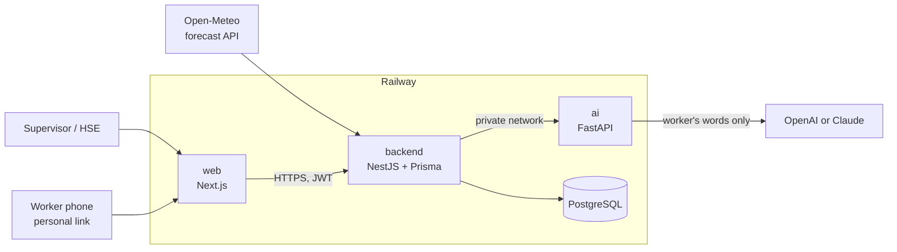

# Architecture

Three services and a database, all deployed from one repository.

| Service | Does | Does not |
| --- | --- | --- |
| `ai` (Python, FastAPI) | Computes WBGT, exposure limits, work/rest minutes and levels (`/assess`); turns check-in text or audio into symptoms (`/intake`); builds the planning estimate (`/plan`) | Store anything. It is stateless and is not reachable from the internet. |
| `backend` (TypeScript, NestJS, Prisma) | Sign-in and roles, the 15-minute risk timer, weather fetching, alert rules and message templates, check-ins, consent, audit log, replays | Make any heat or symptom judgement itself: it asks `ai` |
| `web` (Next.js) | Supervisor dashboard, worker page, planning view | Hold data: the worker page keeps nothing in the browser |

## The four flows

**1. Risk run, every 15 minutes.** For each site the backend fetches the next hours of forecast from Open-Meteo and stores it. For each crew on shift it calls `/assess` for the current hour and the next six, with the crew's workload, clothing adjustment and rest area. Workers in their first 14 days on site, and workers with recent symptoms, are assessed again with stricter settings and get their own schedule. Results are stored as `RiskAssessment` and `WorkerRisk` rows. Alert rules then compare each crew and worker with their last state and queue messages in the recipient's language: level changes, schedule changes and reminders. If the weather fetch fails, the last stored forecast is used and every level is raised one step (`fallback`).

**2. Check-in.** A worker taps symptoms or types (or records) a message on their page. The backend checks consent, then sends only the text or audio to `/intake`. The result is eleven yes/no symptoms and a red-flag decision. Any symptom gives the worker a stricter schedule and puts them on the supervisor's "needs check" list; a red flag starts the emergency messages. The supervisor sees that a worker needs checking, not what they reported, except in an emergency.

**3. Planning.** `GET /sites/:id/plan` fetches, from Open-Meteo's Previous Runs API, the last weeks of day-ahead forecasts paired with what each hour turned out to be, plus tomorrow's forecast. `/plan` returns tomorrow's schedule twice: from the raw forecast and from the adaptive correction, which is switched off unless the recent forecast has been biased.

**4. Replay.** `POST /sites/:id/replay?date=YYYY-MM-DD` (HSE and admin only) runs a past summer day through the same code using recorded weather from `data/raw`, and stores it marked `isReplay`. This is how the demo shows a full hot shift outside summer.

## Data model

Prisma schema: `backend/prisma/schema.prisma`.

- `Organization` → `Site` (location, timezone, rest area) → `Crew` (supervisor) → `Worker` (pseudonym, language, acclimatization date; no legal name)
- `TaskType` (metabolic watts, clothing adjustment) and `Shift` (crew, task, times)
- `WeatherSnapshot`, `RiskAssessment` (one per crew per hour of outlook), `WorkerRisk` (stricter individual schedule and its reasons)
- `CheckIn` (symptoms, red flag, which extractor decided), `Alert` (audience, reason, message as sent, acknowledgement)
- `Consent` (scope, granted, withdrawn), `AuditLog`

## Security

- Staff sign in with email and password and get a 12-hour token. Supervisors can reach only their own crews; HSE and admin see the organization. Checked on every route (`backend/src/auth/access.service.ts`).
- Workers use a personal link holding a 30-day token of a different kind. It opens only `/worker/me/*`, and reissuing or revoking it cuts off every earlier link. See [governance.md](governance.md).
- The `ai` service is on Railway's private network only. API keys for the language model live in its environment.

## Deployment

Railway, one project: `web`, `backend`, `ai` and PostgreSQL, each built from a Dockerfile at the repository root. The `ai` image trains the planning model during the build. The backend applies database migrations when it starts. Steps: [DEPLOY.md](../DEPLOY.md).

The risk timer runs inside the backend process, so the backend runs as a single replica. A larger deployment would move it to a job queue (BullMQ and Redis were planned and cut for time).
